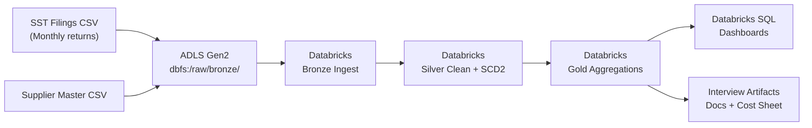

# SST Accounting Data Lakehouse — Architecture

## Overview

A production-grade medallion data lakehouse for Malaysian SST compliance
analytics, built on Azure Databricks. Transforms raw SST-03 monthly filing
CSVs into BI-ready gold marts through Bronze → Silver → Gold processing.

## System Context

## Component Details

### Compute
- **Platform:** Azure Databricks (Free Edition)
- **Cluster:** Single-node, DBR 14.3 LTS, Spark 3.5.0
- **Type:** Job cluster (ephemeral, cost-optimized)
- **Auto-termination:** 60 minutes idle

### Storage
| Zone | Path | Format | Purpose |
|------|------|--------|---------|
| Raw | `dbfs:/raw/bronze/` | CSV | Source files |
| Bronze | `dbfs:/raw/bronze/bronze/` | Delta | Schema-enforced raw |
| Silver | `dbfs:/raw/silver/` | Delta | Cleaned, validated, deduped |
| Gold | `dbfs:/raw/gold/` | Delta | Pre-aggregated BI marts |

### Processing Layers

**Bronze** — Raw ingestion with explicit schema enforcement.
No transformations. Time travel enabled for audit.

**Silver** — Data quality gates, deduplication, SCD2 for supplier
master data. Invalid records flagged, not dropped.

**Gold** — Four BI marts:
- `sst_liability_summary` — Revenue, SST payable, effective rates by period/state/sector
- `supplier_compliance` — Risk scoring, overdue filing rates
- `filing_status_trend` — Pivot of submission status over time
- `top_sst_payers` — Top 20 SST contributors

### Orchestration

Databricks Workflows with three dependent tasks:
1. `bronze_ingest` → `silver_processing` → `gold_aggregations`
- Task values passed between stages (`dbutils.jobs.taskValues`)
- Email notification on failure
- Scheduled daily at 2 AM (Asia/Kuala_Lumpur)

### Security & Compliance (PDPA/SST)

- **PII masking:** Supplier names hashed with SHA-256 in Silver
- **Data retention:** 30-day time travel, 7-day vacuum retention
- **Access control:** Gold tables read-only for BI users
- **Audit trail:** Delta time travel provides full history
- **SST compliance:** Filing status tracked, overdue flagged

## Cost Estimate (Production)

| Component | Monthly Cost (USD) |
|-----------|-------------------|
| Databricks DBUs (4 workers, 8h/day) | ~$400 |
| ADLS Gen2 Storage (500 GB) | ~$15 |
| Databricks SQL Warehouse (small) | ~$100 |
| **Total** | **~$515/month** |

Free Edition: ~4-6 DBUs/month, 1 worker, no Unity Catalog.

## Key Design Decisions

1. **Delta over Parquet** — ACID transactions, time travel for audit,
   OPTIMIZE + Z-ORDER for query performance
2. **Medallion architecture** — Clear contracts between layers,
   each layer has a single responsibility
3. **Explicit schemas** — No schema inference in production; prevents
   silent data quality failures
4. **SCD2 for suppliers** — Full history tracking, critical for
   SST compliance audits
5. **Databricks Workflows over Airflow** — Native integration, task
   values, simpler ops. Airflow for multi-cloud needs.

## Interview Narrative

*"I built this as a portfolio project to demonstrate production-grade
data engineering on Azure Databricks. The key design challenge was
implementing SCD2 for supplier master data while maintaining ACID
guarantees through Delta Lake. I used Databricks Workflows for
orchestration with task values between stages, and I can walk through
the cost optimization — job clusters vs all-purpose, Z-ORDER for
query performance, and the Free Edition constraints."*